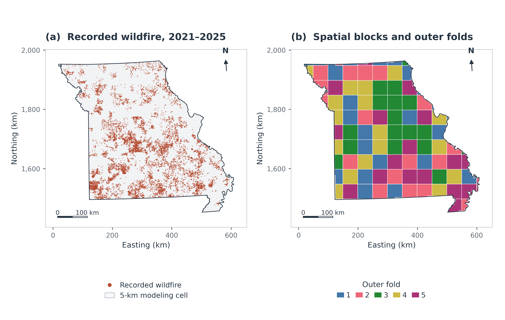

# Missouri wildfire susceptibility

Research materials for **From Random to Spatial Validation: An Explainable GeoAI Framework for Wildfire Susceptibility Mapping**, by Mehdi Javid and Reda Amer.

Prepared for MDPI *Remote Sensing*. This checkout contains the processed inputs,
analysis code, saved estimators/predictions, and figures supporting the paper.
It does not assert that the paper has been submitted or published.



## Local package verification

Prepared locally on 13 October 2026. Frozen-artifact checks, saved metric/SHAP
checks, fold reconstruction, and regeneration of all 13 figures passed.
Reports are retained in [docs/verification/](docs/verification/).
`PACKAGE_MANIFEST.json` records the exact size and SHA-256 of every supplied
file except the manifest itself. Keep the folder structure intact when extracting
the ZIP or uploading its contents. Model searches
and upstream raw-data extraction were not rerun for this final package check.
These verification checks were completed locally before upload. After extraction, use the commands
below; they create their working outputs without changing the frozen artifacts.

## Start here

```sh
conda env create -f environment.yml
conda activate missouri-wildfire
python scripts/verify_repository.py
python scripts/reproduce_validation.py --mode artifacts
python scripts/make_paper_figures.py
```

Run from this repository's root. Python 3.11.15 and package versions are pinned.
Verification reads the frozen artifacts; it does not fit models. Figure generation
uses processed inputs and saved results, writing to `figures/generated/`.
The authoritative paper figures remain in `figures/paper/`. Validation and optional
SHAP runs write to `results/new_runs/`; frozen research artifacts are preserved.

## Paper results

The modeling checkpoint contains 7,229 cells, 33 encoded predictors, 94 spatial
blocks, 2,988 cells with a recorded 2021–2025 wildfire, and 4,241 without a record.
No record is not confirmed fire absence. Final RF scores represent relative
retrospective susceptibility, rather than calibrated future-fire probabilities.

| Evaluation | Mean ROC-AUC ± sample SD | Pooled OOF ROC-AUC |
|---|---:|---:|
| RF, random baseline | 0.768 ± 0.018 | 0.767 |
| RF, GroupKFold spatial baseline | 0.673 ± 0.022 | 0.670 |
| RF, tuned spatial CV | 0.663 ± 0.030 | 0.661 |
| XGBoost, tuned spatial CV | 0.649 ± 0.025 | 0.647 |
| RF, nested spatial CV | 0.662 ± 0.031 | 0.659 |
| XGBoost, nested spatial CV | 0.647 ± 0.032 | 0.645 |

The baseline RF settings are identical; random and spatial partitioning differ.
Nested RF and XGBoost use shared outer and inner assignments. Full-data SHAP and
the mapped RF scores are separate from nested held-out predictions. Preprocessing
uses the fixed statewide covariate surface before CV, as documented in Methods.

## Contents

| Directory/file | Purpose |
|---|---|
| `data/` | Encoded checkpoint, modeled cell geometry and derived map inputs |
| `models/` | Preserved fitted RF and XGBoost estimators |
| `results/` | Saved fold metrics, predictions, sensitivity and SHAP summaries |
| `scripts/` | Verification, selective evaluation, optional refitting and figure generation |
| `figures/paper/` | Eight main and five supplementary figures, PNG/PDF |
| `docs/` | Methods, source conventions, figure mapping and release notes |
| `etl.ipynb` | Historical notebook source; saved outputs and execution counts cleared |
| `CITATION.cff` | Software citation and unpublished-paper metadata |

The notebook documents the historical workflow and is not a clean Run All entry
point. The commands above reproduce the processed-input analysis. Source rasters,
upstream exports, and the full incident database are acquisition-stage inputs;
see [data sources](docs/data_sources.md). Historical sensitivity and fold-SHAP
tables support descriptive calculations of the saved summaries.

## Optional computation

```sh
# Refit the controlled baselines and reconstruct nested XGBoost if caches differ.
python scripts/reproduce_validation.py --mode all --workers 4
# Independently rerun the recorded nested RF search using frozen split assignments.
python scripts/reproduce_nested_rf.py --workers 4
# Re-evaluate full-data SHAP from the preserved final estimator, without fitting it.
python scripts/prepare_shap.py
```

Model searches are expensive. The saved results allow verification and figure
reproduction without them. Nested RF refits write to `results/new_runs/nested_rf/`
and compare with the frozen OOF outputs. See [reproducibility](docs/reproducibility.md).

## Citation, licensing and publication

Use [CITATION.cff](CITATION.cff) and cite the associated paper when its publication
details become available. No DOI or publication date has been invented.

[MIT](LICENSE) applies to the project-owned code and accompanying documentation.
Data, trained models and rendered figures have distinct provenance; see
[licensing and attribution](DATA_LICENSE.md). Provider terms remain applicable.
Python `joblib` models are serialized executable objects: verify their hashes
before loading and use the supplied author-controlled artifacts.

Funding: Geospatial Workforce Development Program. Both authors contributed
equally to conceptualization, methodology, analysis, and manuscript preparation.

Repository: https://github.com/mcavid/missouri-wildfire-explainable-geoai. See [publication checklist](docs/publication_checklist.md)
for reviewer access, release metadata and eventual archival DOI steps.
